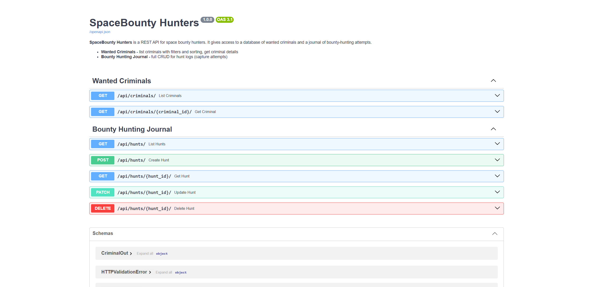

# SpaceBounty Hunters API



Stack: Python 3.12, FastAPI, SQLAlchemy 2, PostgreSQL 16, Docker.

## Quick start

Important: `.env` variables are required to run the app.

Create `.env` based on the provided `.env.example` (or just rename it to `.env`) and fill the variables with real values.

Then run:

```
docker compose up --build
```

On first start the tables are created and the database is prefilled with 6 criminals and 10 hunt logs.

| What       | URL                        |
|------------|----------------------------|
| API        | http://localhost:8000      |
| Swagger UI | http://localhost:8000/docs |

## Postman

1. Import `postman-collections/postman_collection.json`.
2. Make sure the application is running.
3. Run the requests.

The collection variable `base_url` is `http://localhost:8000`. The "Create hunt log" request saves the new ID into the `hunt_id` variable, so Get, Update and Delete work as a chain.

## Endpoints

| Method | URL                     | Description                                                              |
|--------|-------------------------|--------------------------------------------------------------------------|
| GET    | `/api/criminals/`       | List criminals (`min_reward`, `max_reward`, `armed`, `has_crew`, `escape_master`, `sort=reward\|-reward`) |
| GET    | `/api/criminals/{id}/`  | Criminal details                                                         |
| GET    | `/api/hunts/`           | List hunt logs (`criminal_id`)                                           |
| GET    | `/api/hunts/{id}/`      | Get one hunt log                                                         |
| POST   | `/api/hunts/`           | Record a capture attempt                                                 |
| PATCH  | `/api/hunts/{id}/`      | Update `success` or `notes`                                              |
| DELETE | `/api/hunts/{id}/`      | Delete a hunt log                                                        |

## Useful commands

```
docker compose up --build    # start with build
docker compose down          # stop, keep data
docker compose down -v       # stop and DELETE data
```
